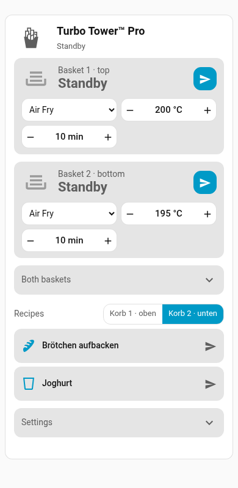

# VeSync Air Fryer Card

A Lovelace card for dual-basket VeSync air fryers (developed for the Cosori Turbo Tower Pro, `CAF-DC111S-AEU`): status, controls and a recipe list in one card. Colors, fonts and texts follow your Home Assistant theme and language (English and German included). Unofficial; not affiliated with or endorsed by VeSync or COSORI, product names are trademarks of their respective owners.



Each basket shows its status and a form (program, temperature, time) with the values the appliance allows. One action button is Start, Send, Pause or Resume depending on the state, plus Stop when there is something to stop. "Both baskets", the recipes and the settings are collapsed below; tap a title to open it. Your browser remembers what you opened.

> [!WARNING]
> **Start** and recipes with "Start immediately" start heating remotely, at your own risk. In the EU, the VeSync app asks you to start cooking on the appliance; **Send** does that (the appliance waits for its Start/Pause button). See [Safety](https://github.com/KindOfNerdy/ha-vesync-turbotower#safety) in the integration.

## Requirements

- Home Assistant with the VeSync integration that provides per-basket entities. Until this is part of Home Assistant Core, that is the custom integration [ha-vesync-turbotower](https://github.com/KindOfNerdy/ha-vesync-turbotower).
- Tested with the Turbo Tower Pro (CAF-DC111S-AEU) on Home Assistant 2026.11.

## Installation

**Home Assistant 2026.11 and later:** *Settings → Marketplace → Add from link*, enter `https://github.com/KindOfNerdy/vesync-airfryer-card`.

**Earlier versions:** add the repository in HACS as a custom repository of type *Dashboard*, then download the card.

[](https://my.home-assistant.io/redirect/hacs_repository/?owner=KindOfNerdy&repository=vesync-airfryer-card&category=plugin)

## Usage

Add "VeSync Air Fryer Card" from the card picker and set it up in the visual editor, or use YAML:

```yaml
type: custom:vesync-airfryer-card
mode: full   # full | control | recipes
```

The card finds the entities itself. Set `device_id` only if you have more than one VeSync air fryer. Everything else is optional.

## Recipes

A recipe is a script that calls `vesync.start_cook`. The card lists every script that carries a label of your choice. Tap a tile to run it.

1. Import the blueprint:

   [](https://my.home-assistant.io/redirect/blueprint_import/?blueprint_url=https%3A%2F%2Fgithub.com%2FKindOfNerdy%2Fvesync-airfryer-card%2Fblob%2Fmain%2Fblueprints%2Fscript%2Fturbo_tower_recipe.yaml)

2. Create a script from the blueprint "Turbo Tower recipe" (program, temperature, time, basket).
3. Give the script a name and an icon (without one the card shows `mdi:chef-hat`). The blueprint cannot set these.
4. Add a label to the script and select it as `recipe_label` in the card's settings. If you name the label **Airfryer-Rezept** (ID `airfryer_rezept`), no setting is needed.

The card reads program, temperature and time from the script for the detail line. That needs an administrator account; for other users the tile still works.

### Start or send

Every start either **starts** cooking right away or **sends** the values to the appliance, where you confirm with its Start button. This is set in two places:

| Where | Applies to |
|---|---|
| Card, switch "Action button" under *Settings* (only shown when the integration's Start buttons are enabled) | The basket buttons and "Both baskets" in the card |
| Recipe script, blueprint input "Start immediately" | That one recipe, however it is started |

**Recipes always use their own setting; the card's switch does not change them.** The icon on each recipe (play = start, arrow = send) shows that setting; "Start immediately" is off by default, so a new recipe only sends. To control both with one switch, create an `input_boolean` helper and set it as `direct_start_entity` in the card **and** as "Start-immediately helper" in the blueprint. Without a helper, the card's switch is only remembered by the browser.

### Optional helpers

| Helper | Option | Shows up as |
|---|---|---|
| `input_boolean` | `direct_start_entity` | The "Action button" switch under *Settings* (see above) |
| `input_select` with options that contain the basket number, e.g. `Basket 1 · top`, `Basket 2 · bottom` | `basket_entity` | Basket switch next to "Recipes"; used by recipes set to "basket from helper" |

## Options

| Option | Default | Description |
|---|---|---|
| `mode` | `full` | `full` (controls and recipes), `control` or `recipes` |
| `hide` | – | Sections to hide: `header`, `form` (program, temperature and time of each basket), `both` (both baskets), `settings` |
| `name` | device name | Title in the header |
| `device_id` | first air fryer | Device of the air fryer |
| `direct_start_entity` | – | `input_boolean` for start/send, see above |
| `basket_entity` | – | `input_select` for the recipe basket, see above |
| `confirm_stop` | `true` | Stop needs a second tap to confirm |
| `recipe_label` | `airfryer_rezept` | Label (or list) that marks recipe scripts; any label works, the default is only a fallback |
| `recipe_filter` | – | Extra filter on script names, e.g. `script.my_recipes_*` |
| `recipes` | – | Explicit list of script entity IDs (replaces label and filter; YAML only) |
| `images` | – | Your own pictures, see below |

## Pictures

By default the card shows icons: `mdi:french-fries` for the appliance, `mdi:tray-full` for a basket. For your own pictures, put them below `/config/www` and reference them:

```yaml
images:
  device: /local/air_fryer/device.webp
  basket: /local/air_fryer/basket_{n}.webp          # {n} becomes 1 or 2
  basket_out: /local/air_fryer/basket_out_{n}.webp  # basket pulled out
```

The card uses only the entities of the integration; it does not talk to the VeSync cloud itself.
