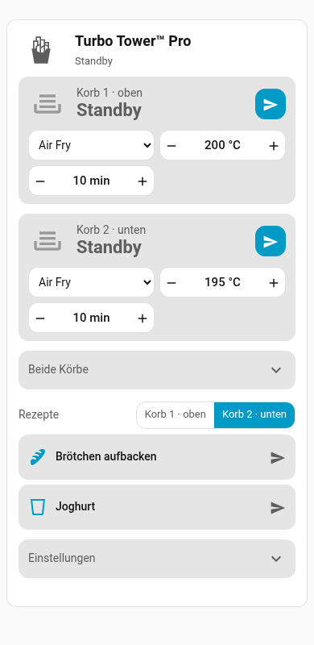

# VeSync Air Fryer Card

A Lovelace card for dual-basket VeSync air fryers (developed for the Cosori Turbo Tower Pro, `CAF-DC111S-AEU`): status, controls and a recipe list in one card. Colors, fonts and texts follow your Home Assistant theme and language.



One card, three variants:

| `mode` | Shows |
|---|---|
| `full` (default) | Controls and recipes |
| `control` | Status and controls only |
| `recipes` | Recipe list only |

## Requirements

- Home Assistant with the VeSync integration that provides per-basket entities (cooking status, program, temperature, time, start/pause/resume/stop buttons). Until this is part of Home Assistant Core, that is the custom integration [ha-vesync-turbotower](https://github.com/KindOfNerdy/ha-vesync-turbotower).
- Tested only with the Turbo Tower Pro (CAF-DC111S-AEU) on Home Assistant 2026.11.

## Installation

**Home Assistant 2026.11 and later (Marketplace):** open *Settings → Marketplace*, choose *Add from link* and enter `https://github.com/KindOfNerdy/vesync-airfryer-card`.

**Earlier versions (HACS):**

[](https://my.home-assistant.io/redirect/hacs_repository/?owner=KindOfNerdy&repository=vesync-airfryer-card&category=plugin)

Or add the repository in HACS as a custom repository of type *Dashboard*, then download the card.

## Usage

Add the card from the card picker ("VeSync Air Fryer Card") and set it up in the visual editor, or use YAML. Everything below can be set in the editor except `recipes`, which is YAML only.

```yaml
type: custom:vesync-airfryer-card
mode: full
```

The card finds the air fryer's entities itself. Set `device_id` only if you have more than one VeSync air fryer.

### Options

| Option | Default | Description |
|---|---|---|
| `mode` | `full` | `full`, `control` or `recipes` |
| `hide` | – | Sections to hide: `header`, `both` (both baskets), `settings` |
| `device_id` | first air fryer | Device of the air fryer |
| `direct_start_entity` | – | Optional `input_boolean` behind the "Action button" switch in the card's settings. On = start right away, off = only send the values to the appliance. Recipe scripts can read the same helper. Without a helper the browser remembers the choice. |
| `confirm_stop` | `true` | Tap Stop twice: the first tap asks, the second stops. Off = the first tap stops. |
| `basket_entity` | – | Optional `input_select` for recipes whose basket is taken from a helper |
| `recipe_label` | `airfryer_rezept` | Label (or list of labels) that marks recipe scripts. Any label works; set the one you use, the default is only a fallback |
| `recipe_filter` | – | Optional extra filter on script names, e.g. `script.my_recipes_*` |
| `recipes` | – | Explicit list of script entity IDs (replaces label and filter) |
| `images` | – | Optional pictures, see below |

### How it works

- **Controls:** each basket has a status, a form (program, temperature, time) and one action button that is Start, Send, Pause or Resume depending on the state, plus Stop when there is something to stop. Temperature and time offer the values the appliance allows for the program (a picker, or the +/- buttons). "Both baskets" and the settings are collapsed below; both can be hidden with `hide`.
- **Start or send:** the switch in the card's settings decides whether the action button starts cooking right away or only sends the values to the appliance, where you confirm on the display. If you set `direct_start_entity`, the switch is that helper, so every dashboard and script sees the same state. If you hide the settings section, change the helper instead.
- **Recipes:** every script that carries the recipe label is a recipe (see `recipe_label`). Tap it to run it. Program, temperature and time are read from the script's configuration, which needs an administrator account; for other users the tile still works, only the details line stays empty.

### Pictures

By default the card shows Material Design icons: `mdi:french-fries` for the appliance and `mdi:tray-full` for a basket. To use your own pictures, put them below `/config/www` and reference them:

```yaml
images:
  device: /local/air_fryer/device.webp
  basket: /local/air_fryer/basket_{n}.webp      # {n} becomes 1 or 2
  basket_out: /local/air_fryer/basket_out_{n}.webp  # basket pulled out
```

## Recipes

1. Import the blueprint:

   [](https://my.home-assistant.io/redirect/blueprint_import/?blueprint_url=https%3A%2F%2Fgithub.com%2FKindOfNerdy%2Fvesync-airfryer-card%2Fblob%2Fmain%2Fblueprints%2Fscript%2Fturbo_tower_recipe.yaml)

2. Create a script from the blueprint "Turbo Tower recipe" (program, temperature, time, basket).
3. Give the script a name and an icon (without an icon the card shows `mdi:chef-hat`).
4. Add a label to the script (create it first if needed) and select it as `recipe_label` in the card's settings. The script then shows up in the card. If you name the label **Airfryer-Rezept** (ID `airfryer_rezept`), no setting is needed.

The blueprint is a starting point; any script that carries the recipe label is listed. The blueprint cannot set a script's name, icon or label, so do that in the script's settings.

## Languages

The card follows the Home Assistant language (English and German texts included). States and program names come from the integration's translations.

## Notes

- The card uses the entities of the integration only; it does not talk to the VeSync cloud itself.
- Reading recipe details uses an administrator-only API (`config/script/config`).
